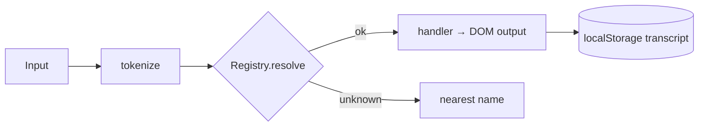

This website is a terminal, but nothing here runs a real shell. Every command is an explicitly registered TypeScript object, and input is treated as untrusted text that is only ever tokenized and matched.

## The registry

Each command declares its name, aliases, a description, an optional argument completer and a handler:

```ts
export interface Command<Ctx> {
  name: string;
  desc: string;
  aliases?: string[];
  args?: (typed: string[]) => Arg[];
  run: (args: string[], ctx: Ctx) => void;
}
```

Resolution happens in a fixed order:

| Step | Rule | Example |
| --- | --- | --- |
| 1 | Exact name or alias, case-insensitive | `WhoAmI` → `about` |
| 2 | Unique prefix | `exper` → `experience` |
| 3 | Ambiguous prefix lists options | `exp` → `experience`, `expertise` |
| 4 | Typo hint by edit distance | `experince` → `experience` |

## Typo suggestions

Suggestions use the optimal string alignment distance — Levenshtein plus adjacent transpositions:

$$
d(i,j) = \min \begin{cases} d(i-1,j) + 1 \\ d(i,j-1) + 1 \\ d(i-1,j-1) + [a_i \ne b_j] \\ d(i-2,j-2) + 1 & \text{if } a_i = b_{j-1},\ a_{i-1} = b_j \end{cases}
$$

A suggestion is shown only when the distance is at most $\max(1, \lfloor n/3 \rfloor)$ for an input of length $n$, so random input does not produce confident nonsense.

## Where things run



The session is persisted as a transcript of command lines, not serialized HTML. Because every handler is deterministic, replaying the transcript rebuilds the exact same screen after a reload or after returning from an article.
